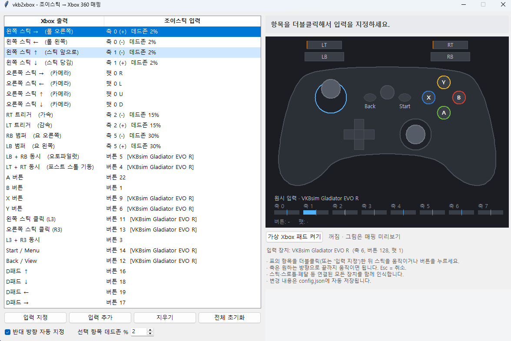

# vkb2xbox

[](README.md)
[](README.en.md)

A Windows mapping tool that turns input from a VKB joystick (or any HOTAS, throttle, or rudder pedals) into a **virtual Xbox 360 controller**.

Use it when you want to play a gamepad-only game (the Ace Combat series, for example) with a flight stick.
You connect the stick's axes, buttons, and hats to the Xbox pad's sticks, triggers, and buttons however you like, and the game sees an ordinary Xbox 360 pad.



> The program's interface is in Korean only for now.

## Features

- Free mapping: axis → stick / trigger / button, button or hat → button / stick direction
- **Multiple devices at once**: every connected joystick is recognized (stick + separate throttle + rudder pedals), and each mapping remembers which device it belongs to. Plugging or unplugging while running is picked up automatically
- Several inputs can drive one output
- One input can press two buttons together (`LB+RB`, `LT+RT`, `L3+R3`)
- Per-axis deadzone
- GUI: assign a mapping by moving the stick, and watch the virtual pad's real output live
- CLI: mapping wizard (`setup`), run the conversion (`run`), view raw input (`monitor`)

## Quick start (exe)

To use it without Python, download `vkb2xbox.exe` from [Releases](https://github.com/Cha-nu/VKBTOXBOX/releases) and run it.

- On first run it starts with my own mapping (made for the VKB Gladiator EVO R). Your changes are saved to `config.json` next to the exe.
- Creating the virtual pad needs the **ViGEmBus driver**. See [Installing the ViGEmBus driver](#installing-the-vigembus-driver) below.
- To build it yourself, run `pip install pyinstaller` and then `build.bat`.

## Installing the ViGEmBus driver

This driver creates the virtual Xbox 360 controller. You only install it once; pick whichever method suits you.

**Option 1 — from the program**

If the driver is missing when you click **가상 Xbox 패드 켜기** (Turn on virtual Xbox pad) in `vkb2xbox.exe`, it asks whether to run the installer. Click **Yes**, finish the installation, then click the button again.

**Option 2 — winget**

Run this in PowerShell or Command Prompt.

```
winget install ViGEm.ViGEmBus
```

**Option 3 — manual download**

Download `ViGEmBus_x.xx.x_x64_x86_arm64.exe` from the [ViGEmBus releases page](https://github.com/nefarius/ViGEmBus/releases/latest) and run it.

Allow the administrator prompt if one appears during installation. If the virtual pad still can't be created afterwards, restart your PC.

To check that it is installed, look for "ViGEm Bus Driver" under **Settings → Apps → Installed apps**, or run:

```
winget list ViGEm.ViGEmBus
```

## Installation (running from source)

1. Install [Python 3](https://www.python.org/downloads/) (tick "Add python.exe to PATH" in the installer)
2. Install the packages

   ```
   pip install -r requirements.txt
   ```

   A **ViGEmBus driver** installer window appears while `vgamepad` is being installed. It is needed to create the virtual pad, so complete it.

| Requirement | Purpose |
| --- | --- |
| pygame | Reads joystick input |
| vgamepad | Creates the virtual Xbox 360 controller |
| ViGEmBus driver | The virtual device driver vgamepad uses |

## Usage

### GUI (recommended)

Run `gui.bat`.

1. Double-click an Xbox output in the table, then move the stick or press a button to assign that input. For an axis, push it all the way in the direction you want.
2. Click **가상 Xbox 패드 켜기** (Turn on virtual Xbox pad). The picture on the right shows the virtual pad's real output.
3. Leave the window open and start your game.

Mappings are saved to `config.json` automatically.

Use the **Language / 언어** menu at the bottom right of the window to switch between English and Korean. It defaults to your Windows display language, and your choice is saved in `config.json`.

### Command line

```
python vkb2xbox.py setup     mapping wizard
python vkb2xbox.py run       run the conversion (start it before the game)
python vkb2xbox.py monitor   view the stick's raw input
```

`setup.bat` and `run.bat` do the same. Use `--config <path>` to work with a different config file.

## Config file

`config.example.json` is the mapping I use. You can copy it to `config.json` as a starting point, but button numbers differ by stick model and firmware settings, so assigning them yourself is the better route.

```json
{
  "device": "VKB",
  "bindings": {
    "LX+": [{"type": "axis", "index": 0, "sign": 1, "min": 0.02, "max": 1.0, "device": "stick name"}],
    "RT":  [{"type": "axis", "index": 2, "sign": 1, "min": 0.15, "max": 1.0, "device": "throttle name"}],
    "A":   [{"type": "button", "index": 21}],
    "RX+": [{"type": "hat", "index": 0, "dir": "R"}]
  }
}
```

- `device` on each input: the name of the joystick that input belongs to. It is filled in automatically when you assign through the GUI or `setup`. If two devices share a name, the second and later ones get ` #2` appended.
- `device` at the top: the device used for inputs that have no `device` of their own (mappings made with an older version). It picks the joystick whose name contains this text.
- For an axis, `min` is the deadzone and `sign` is the direction.
- Devices with `Xbox` or `XInput` in their name are never used as input, so the virtual pad's own output isn't read back in.

## Notes

- Games usually read only XInput controller 1. If another pad is plugged in, the virtual pad may become controller 2, so unplug it. The GUI shows a warning in that case.
- Windows may freeze for a few seconds when the virtual pad is turned on, while it rescans its device list.
- Windows only.
